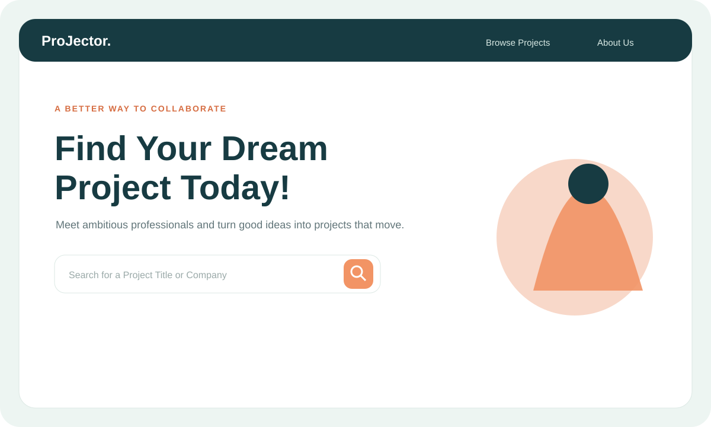

<div align="center">

# ProJector

### A focused workspace for connecting professionals with meaningful projects.

<p>
  
  
  
  
  
</p>

<p>Discover projects, present your skills, and turn the right professional connection into visible progress.</p>

</div>

<br />



<div align="center"><sub>Homepage direction: warm actions, deep teal typography, rounded surfaces, and a low-friction project search.</sub></div>

## Why ProJector?

ProJector is a two-sided platform for professionals and companies. Professionals can build a profile, browse opportunities, apply to projects, collect certificates, and receive recommendations. Companies can publish projects, review applicants, manage project status, and rate completed work.

The product is workflow-first: a project moves from discovery to application, approval, delivery, completion, and feedback without leaving the platform.

## Product surface

| Area | What it supports |
| --- | --- |
| Discovery | Search projects by title, company, category, location, and skills |
| Profiles | Professional and company profiles with contact details, skills, projects, and certificates |
| Collaboration | Apply, leave, approve, reject, and track project participation |
| Recommendations | Suggest projects to professionals using profile skills and project metadata |
| Feedback | Rate projects and professionals after work is completed |
| Administration | View users and create or remove administrative records |

## Architecture

ProJector uses a simple three-layer structure:

1. **Frontend** — React, Material UI, and React Router render the pages in the browser. The Vite development server runs on port `5173`.
2. **Backend** — Flask exposes the JSON API on port `8000`, handles JWT authentication, validates permissions, and coordinates business logic.
3. **Persistence** — Flask-SQLAlchemy maps companies, professionals, admins, projects, ratings, certificates, and notifications to SQLite tables.

The browser communicates with the backend over JSON HTTP requests. The backend reads and writes the database, then returns a JSON response for the frontend to render. Profile images are currently sent as data URLs in API payloads.

### Request lifecycle

1. React collects form or page state.
2. `frontend/src/api.js` adds JSON and bearer-token headers.
3. Flask resolves the route, checks authentication where required, and delegates to a domain module.
4. SQLAlchemy reads or updates the SQLite models.
5. The API returns JSON; the client updates context, local storage, or page state.

## Technology choices

### Frontend

- React 18 with React Router for page navigation.
- Material UI for forms, dialogs, tables, and responsive primitives.
- Vite for local development and production bundling.
- Context providers for header, dashboard, profile, and project refresh state.
- A shared request layer in `frontend/src/api.js`.

### Backend

- Flask application factory in `backend/app.py`.
- Flask-SQLAlchemy for persistence and model access.
- Flask-JWT-Extended for login tokens and protected operations.
- Flask-CORS for local frontend/API development.
- Werkzeug password hashing for company, professional, and admin credentials.
- SQLite for local/demo deployment through SQLAlchemy.

## Backend implementation logic

The backend keeps route registration in the application factory and groups business operations by domain:

```text
backend/
├── app.py                 # application factory and route registration
├── extensions.py          # SQLAlchemy and JWT extensions
├── database/models.py     # Company, Professional, Admin, Projects, and related models
└── functions/
    ├── auth.py            # registration, login, logout
    ├── projects.py        # project lifecycle and recommendations
    ├── user.py            # profile and user-type lookups
    ├── edit.py            # profile and project updates
    ├── rating.py          # project and professional ratings
    ├── certificate.py     # certificates
    └── admin.py           # administration endpoints
```

Passwords are hashed before persistence. Login returns a JWT containing the user id and user type, allowing the frontend to route users to the correct dashboard. Project actions use the current user id and user type from that token to enforce workflow permissions.

The service exposes a lightweight readiness route:

```http
GET /health
```

```json
{"status": "ok", "service": "projector-api"}
```

## HTTP API design

The API uses resource-oriented paths, JSON request bodies, and standard HTTP methods. Protected routes receive:

```http
Authorization: Bearer <jwt>
Content-Type: application/json
```

### Authentication

| Method | Endpoint | Purpose |
| --- | --- | --- |
| `POST` | `/auth/register/company` | Create a company and return a JWT |
| `POST` | `/auth/register/professional` | Create a professional and return a JWT |
| `POST` | `/auth/login` | Authenticate a company, professional, or admin |
| `POST` | `/auth/logout` | Logout placeholder for client-side session cleanup |

### Projects and discovery

| Method | Endpoint | Purpose |
| --- | --- | --- |
| `POST` | `/project/create` | Publish a project |
| `GET` | `/project/list` | List projects available to the current user |
| `GET` | `/project/listall` | Browse all projects |
| `GET` | `/project/details` | Load one project and its workflow state |
| `GET` | `/project/search` | Search project data |
| `GET` | `/project/recommended` | Return skill-based recommendations |
| `POST` | `/project/professional/apply` | Apply to a project |
| `POST` | `/project/professional/leave` | Leave a project |
| `PUT` | `/project/company/complete` | Mark a project complete |
| `PUT` | `/project/company/incomplete` | Reopen an incomplete project |

### Profiles, feedback, and administration

| Method | Endpoint | Purpose |
| --- | --- | --- |
| `GET` | `/user/details/company` | Read company profile details |
| `GET` | `/user/details/professional` | Read professional profile details |
| `PUT` | `/edit/company` | Update company profile |
| `PUT` | `/edit/professional` | Update professional profile |
| `POST` | `/project/professional/rateProject` | Rate a project |
| `POST` | `/project/company/rateProfessional` | Rate a professional |
| `POST` | `/giveCertificate` | Issue a certificate |
| `GET` | `/profile/viewCertificate` | Read profile certificates |
| `GET` | `/admin/allCompanies` | List companies for administrators |
| `GET` | `/admin/allProfessionals` | List professionals for administrators |
| `POST` | `/admin/createAdmin` | Create an administrator |

For the complete route registration, see [`backend/app.py`](backend/app.py).

## Local development

### 1. Start the backend

Use Python 3.11 or newer. The checked-in `backend/venv` folder was created for Windows, so macOS/Linux users should create a local environment:

```bash
cd backend
python3.12 -m venv .venv
source .venv/bin/activate
python -m pip install -r requirements.txt

export FLASK_SQLALCHEMY_DATABASE_URI=sqlite:///db.sqlite3
export FLASK_SECRET_KEY=JEMMA
python -m flask --app app run --host=127.0.0.1 --port=8000
```

Verify the API:

```bash
curl http://127.0.0.1:8000/health
```

### 2. Start the frontend

In a second terminal:

```bash
cd frontend
npm ci
npm run dev
```

The frontend is available at [http://127.0.0.1:5173](http://127.0.0.1:5173). To use a different backend URL, set `VITE_API_URL` before starting Vite.

### 3. Seed local data

The seed script creates demo skills, categories, users, companies, projects, and the default local admin. Run it from `backend` after the environment is active:

```bash
bash db_controller.sh init
```

The local demo admin is `admin@example.com` with password `Password123`. Change or remove demo credentials before any shared deployment.

## Docker deployment

The repository includes `docker-compose.yml` with separate frontend and backend services:

```bash
docker compose up --build
```

| Service | Local port | Responsibility |
| --- | ---: | --- |
| `frontend` | `5173` | Vite/React web client |
| `backend` | `8000` | Flask API and SQLite-backed application |

For production, provide secrets through the environment rather than committing them:

```bash
FLASK_SECRET_KEY=<strong-random-secret>
FLASK_SQLALCHEMY_DATABASE_URI=<database-url>
VITE_API_URL=<public-api-url>
```

Keep the SQLite volume persistent if SQLite is used, or point `FLASK_SQLALCHEMY_DATABASE_URI` at a managed database for multi-instance deployments.

## Verification

```bash
cd frontend
npm run build
npm run lint

cd ../backend
python -m py_compile app.py
```

## Project structure

```text
.
├── backend/       # Flask API, SQLAlchemy models, seed data, tests
├── frontend/      # React pages, components, contexts, and styles
├── docs/          # UI preview and implementation notes
├── docker-compose.yml
└── README.md
```

## License

This repository is maintained as a project platform prototype and is intended for educational and demonstration use.
